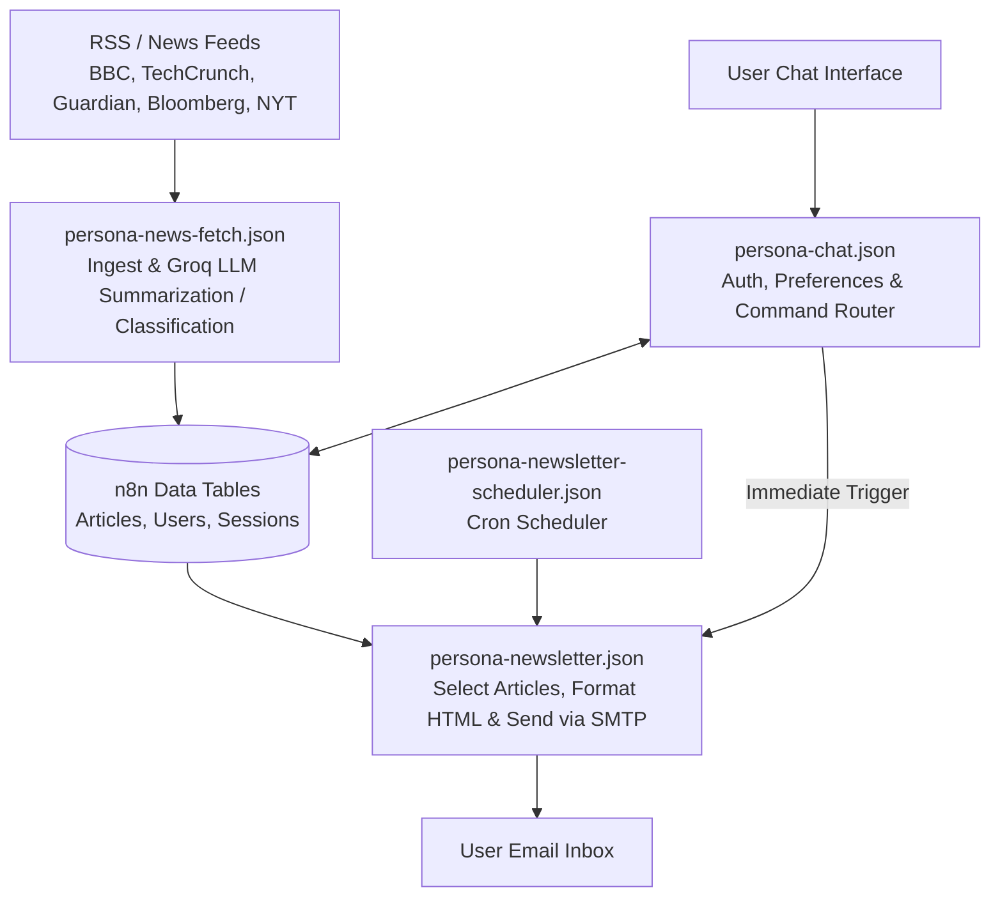

# Persona — AI-Powered Personalized News Assistant (n8n + Groq)

Persona is an automated **AI news aggregation and personalized newsletter system** built with **n8n** and **Groq LLM**. Users can register through a conversational chat interface, configure their preferred topics and delivery schedule, and receive AI-summarized, categorized newsletters via email either on demand or on an automated schedule.

---

## Key Features

- **Conversational Account & Session Management (`persona-chat.json`):**
  - Full user registration (with consent verification), password hashing, login, expiring user sessions, and account deletion directly via chat commands.
- **Automated Multi-Source News Ingestion & AI Classification (`persona-news-fetch.json`):**
  - Fetches live articles from **BBC Technology**, **TechCrunch**, **The Guardian**, **Bloomberg**, and **The New York Times**.
  - Uses **Groq LLM** to summarize articles and classify them across 9 topics.
- **Customizable User Preferences:**
  - Choose favorite topics, configure **1–10 articles per topic** (default: `3`), update delivery email address, and set custom delivery schedules.
- **Smart Freshness & Deduplication (`persona-newsletter.json`):**
  - Prioritizes articles published within the **last 48 hours** (falling back to up to 7 days if needed) and guarantees no duplicate articles appear within the same newsletter.
- **On-Demand & Scheduled Delivery (`persona-newsletter-scheduler.json`):**
  - Trigger an immediate newsletter via the `newsletter` command or enable automated recurring delivery with `subscribe` / `unsubscribe`.

---

## System Architecture



---

## Workflows Overview (`workflows/`)

| Workflow File | Import Order | Description |
| :--- | :---: | :--- |
| `workflows/persona-setup.json` | **1** | Initializes the `Users` and `Sessions` data tables in n8n. |
| `workflows/persona-news-fetch.json` | **2** | Fetches news feeds, runs Groq LLM summarization & topic tagging, and populates the `Articles` table. |
| `workflows/persona-newsletter.json` | **3** | Sub-workflow that filters articles by user topics/freshness, builds the HTML digest, and sends it via SMTP. |
| `workflows/persona-chat.json` | **4** | Conversational chatbot handling authentication, user settings, and immediate newsletter requests. |
| `workflows/persona-newsletter-scheduler.json` | **5** | Periodic scheduler that triggers `persona-newsletter` for subscribed users matching their schedule. |

---

## Installation & Setup

### 1. Clone the Repository

```bash
git clone https://github.com/AlexandrG1209/persona.git
cd persona
```

### 2. Run n8n in Docker

To create and start a new persistent n8n container:

```bash
docker run --name persona-n8n \
  -p 5678:5678 \
  -e N8N_SECURE_COOKIE=false \
  -v persona_n8n_data:/home/node/.n8n \
  n8nio/n8n:2.46.3
```

*(If the container already exists, start it with `docker start persona-n8n`.)*

Open the n8n editor at: **[http://localhost:5678](http://localhost:5678)**

### 3. Import & Configure Workflows

1. Import the 5 JSON files from `workflows/` in the order listed in the table above (`persona-setup` → `persona-news-fetch` → `persona-newsletter` → `persona-chat` → `persona-newsletter-scheduler`).
2. Configure the required n8n credentials (no secrets or API keys are hardcoded in the repository):
   - **Groq API Credential** in `Persona News Fetch`
   - **SMTP Credential** in `Persona Newsletter`
   - **Crypto Credential** (for password hashing) in `Persona Chat`
3. Verify the Data Table, credential, and sub-workflow references in each imported workflow node.
4. Execute **`Persona Setup`** once to create the user/session tables, and execute **`Persona News Fetch`** once to populate the initial articles table.

---

## Supported Topics & Chat Commands

### Available Topics

```text
technology, business, science, world, politics,
health, sports, environment, culture
```

### Chat Commands

| Command | Action |
| :--- | :--- |
| `help` | Display available commands and usage instructions |
| `register` | Create a new user account (with consent prompt) |
| `login` / `logout` | Authenticate or terminate the active session |
| `settings` | View current user profile, topics, article count, and schedule |
| `topics` | Select or update subscribed news categories |
| `articles` | Set the number of articles per topic (`1`–`10`, default `3`) |
| `schedule` | Configure preferred newsletter delivery time |
| `email` | Update account delivery email address |
| `newsletter` | Generate and send a personalized newsletter immediately |
| `subscribe` / `unsubscribe` | Enable or disable scheduled recurring newsletters |
| `delete account` | Permanently remove user account and preferences |
| `cancel` | Abort the current multi-step chat prompt |

---

## Security Design

- **Password Hashing:** User passwords are hashed prior to storage in n8n Data Tables.
- **Session Expiration:** Authenticated chat sessions expire automatically.
- **Strict Recipient Binding:** Newsletters are dispatched exclusively to the verified email stored in the authenticated user's profile.
- **Secret Isolation:** All API keys and SMTP passwords remain isolated inside n8n's encrypted credential store.

---

## Author

- **Alexandr Gorlachev** — [@AlexandrG1209](https://github.com/AlexandrG1209)
